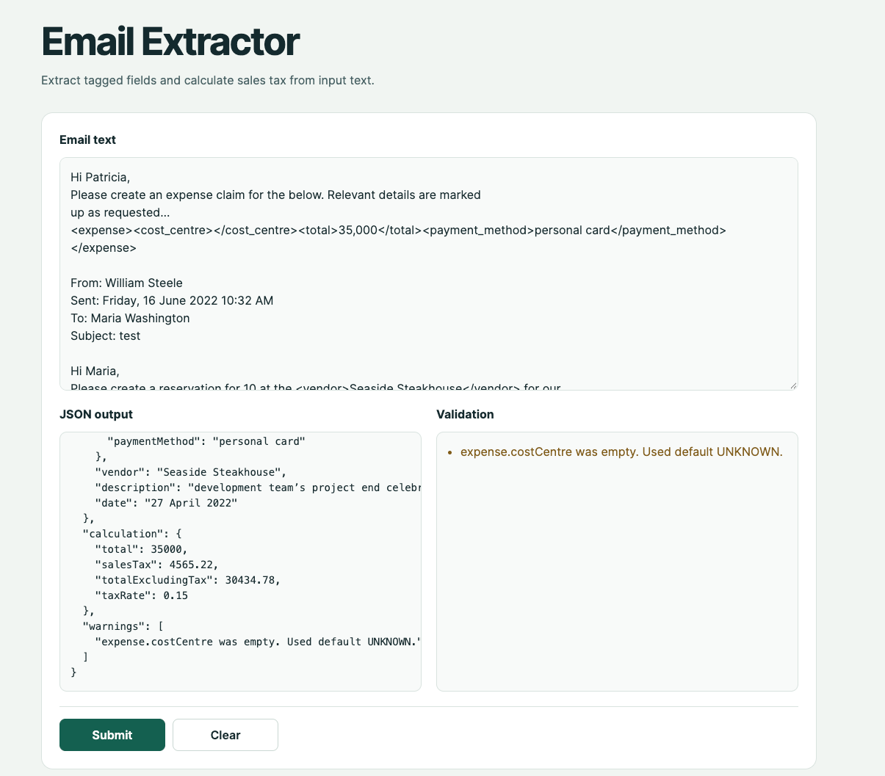
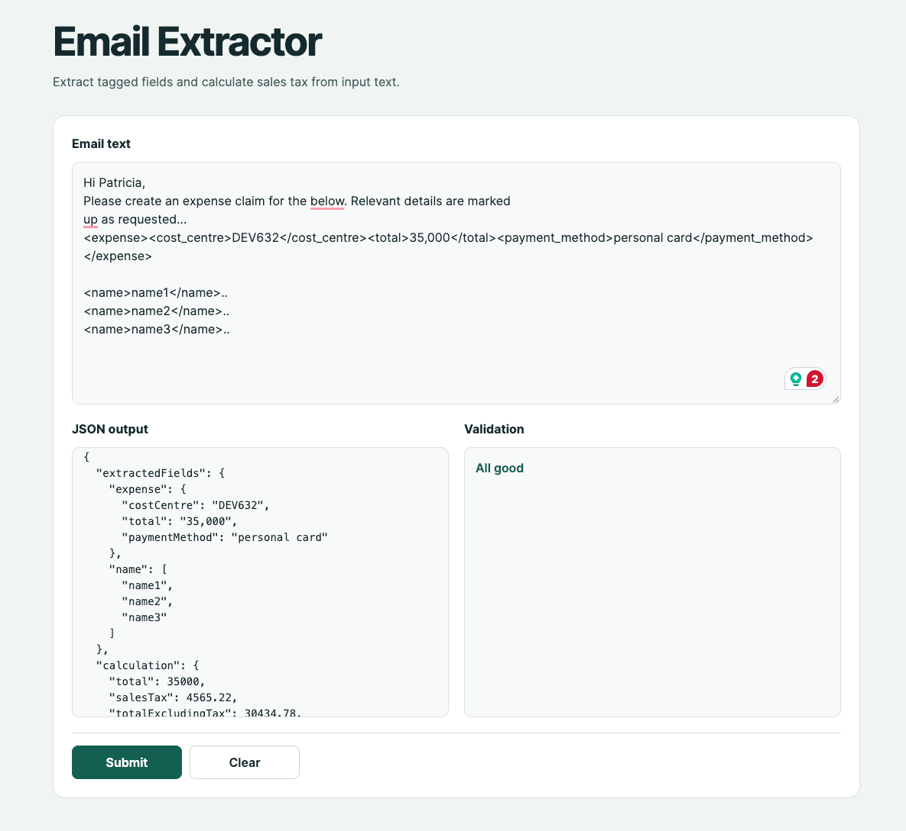
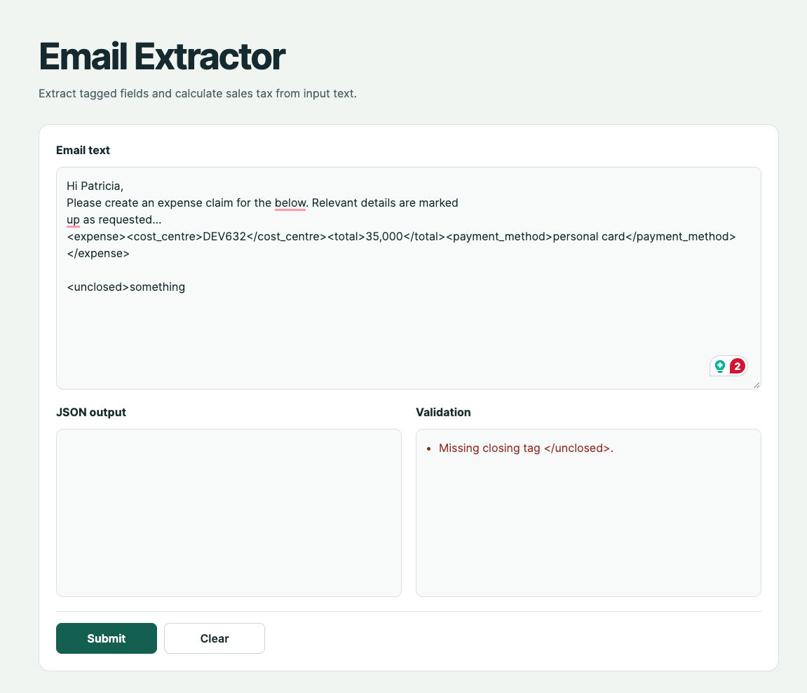

# Email Extractor

## Overview

Email Extractor reads tagged fields embedded in email text and returns structured JSON strings with a sales tax calculation. It has a .NET webapi server and a simple React Frontend.

## Built with

- .NET 10 Minimal API in C#
- React, TypeScript, and Vite
- NUnit for unit and integration tests

## Folders and files

| Path | Purpose |
| --- | --- |
| `APIService/src/Endpoints/` | Registers the extraction route and calls the service. |
| `APIService/src/Contracts/` | Defines the API request and response types. |
| `APIService/src/Services/` | Services that handle the extractions. |
| `APIService/src/Utils/` | Contains tag detection, field naming, and tax helpers. |
| `APIService/src/appsettings.json` | Configurable tax rate and field defaults. |
| `APIService/tests/` | Contains NUnit unit tests and HTTP integration tests. |
| `Client/src/` | Contains the React UI. |

## Assumptions

| Area | Assumption |
| --- | --- |
| Markup | XML tags are either flat pairs or nested blocks of  paired tags inside email text. The supported format is `<tag>value</tag>`. Other XML items such as attributes, namespaces, self-closing tags, entity decoding are outside this scope. |
| Extracted fields | JSON reflects the tag hierarchy and uses camelCase keys. Repeated XML tags under the same parent become arrays in input order. From example: `<name>Tom</name> <name>Mary</name>` becomes {"name":} ["Tom", "Mary"]|
| Totals | At least one `<total>` is required. Multiple totals are also allowed. All totals are tax-inclusive. If several appear, the API sums them before calculating tax once. |
| Defaults | The current configuration applies `UNKNOWN` only to a missing, empty, or whitespace-only `<cost_centre>` directly within `<expense>`. See the configuration section below to see how applying defaults in different ways by configs.|

## Key design decisions

### 1. Configuration

`ExtractionRules` in `APIService/src/appsettings.json` holds the tax rate and default fields. The rules service and extractor are scoped to each request. 

The cost-centre rule in `ExtractionRules:Defaults` is
`{ "Parent": "expense", "Field": "costCentre", "Value": "UNKNOWN" }`.
To apply the fallback at the root level instead, change that rule to
`{ "Parent": "", "Field": "costCentre", "Value": "UNKNOWN" }`.
`Parent` selects the containing tag (an empty string means the root), and `Field`
is the camelCase JSON key. 

### 2. API design

#### Request

`POST /api/extract` accepts an `application/json` body with a required `text` field.

```json
{
  "text": "Please process <expense><total>115</total></expense>."
}
```

#### Response

A successful request returns `200 OK`. The `extractedFields` object contains the tagged values. The `calculation` object contains the combined tax-inclusive total, sales tax, total excluding tax, and the rate used. The `warnings` list reports if defaults values are applied automatically. The Validation panel displays both warning and errors.

```json
// sample JSON output
{
  "extractedFields": {
    "expense": {
      "costCentre": "UNKNOWN",
      "total": "35,000",
      "paymentMethod": "personal card"
    },
    "vendor": "Seaside Steakhouse",
    "description": "development team’s project end celebration",
    "date": "27 April 2022"
  },
  "calculation": {
    "total": 35000,
    "salesTax": 4565.22,
    "totalExcludingTax": 30434.78,
    "taxRate": 0.15
  },
  "warnings": [
    "expense.costCentre was empty. Used default UNKNOWN."
  ]
}
```

#### cURL

```bash
curl -i http://127.0.0.1:7777/api/extract \
  -H 'Content-Type: application/json' \
  --data '{"text":"Please process <expense><total>115</total></expense>."}'
```

#### Error handling

ASP.NET Core validates the required `text` field. The extraction service rejects the entire email when tags are unbalanced or `<total>` is missing. The central exception handler returns `400 Bad Request` with a JSON message for extraction errors and a generic `500` message for unexpected exceptions.

```json
{
  "message": "The email must contain a <total> tag."
}
```

## How to run

Install the .NET 10 SDK and Node.js 24 LTS with npm. Start each command block below from the repository root. The frontend blocks change into `Client` before running npm.

### Build

```bash
dotnet build APIService/src/ApiService.csproj
```

Build the frontend from `Client`.

```bash
cd Client
npm ci
npm run build
```

### Run

Start the API in one terminal from the repository root.

```bash
dotnet run --project APIService/src/ApiService.csproj
```

Open a second terminal at the repository root and start the frontend.

```bash
cd Client
npm run dev
```

Open the local [React app](http://127.0.0.1:7778).

### Test

Run the tests from the repository root.

```bash
dotnet test APIService/tests/ApiService.Tests.csproj
```

The unit tests cover inline values, repeated sibling tags, totals under different parents, missing totals, and default cost centres. The HTTP integration tests cover the example and rejection of an unclosed tag.

### Browser smoke test (Chromium)

Install the frontend dependencies and Chromium once, starting from the repository root:

```bash
cd Client
npm ci
npx playwright install chromium
```

Then, from `Client`, run the smoke test with one command:

```bash
npm run test:e2e
```

Playwright starts and stops the real .NET API and Vite frontend on dedicated ports `17777` and `17778`. Keep those ports free: existing servers are deliberately not reused, so the test cannot silently exercise stale code. You do not need to start the development servers yourself. Failed-test traces are saved in `Client/test-results/`.

## Screenshots




